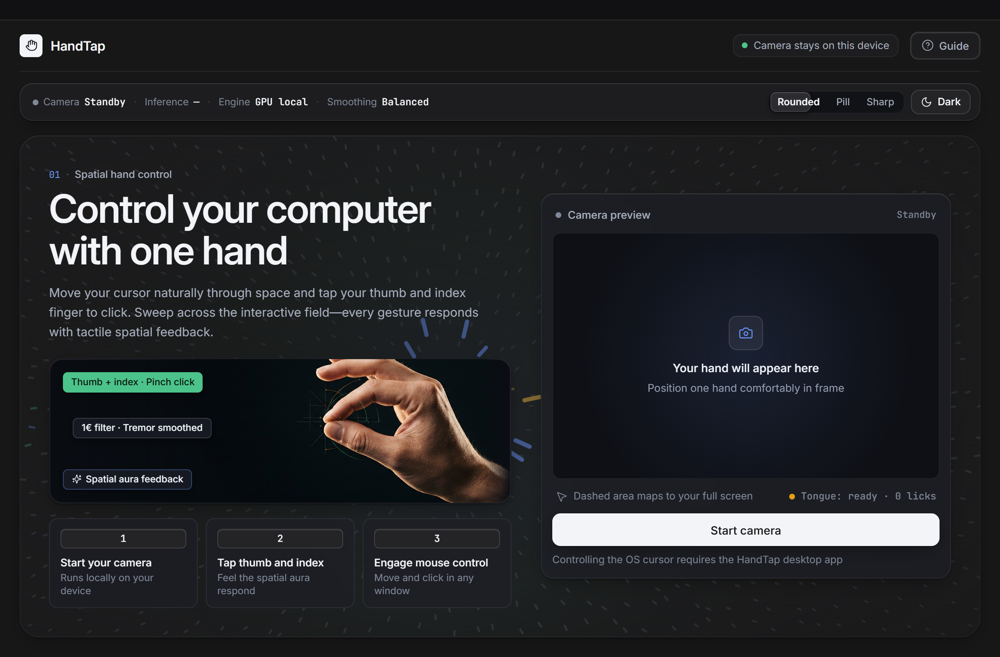
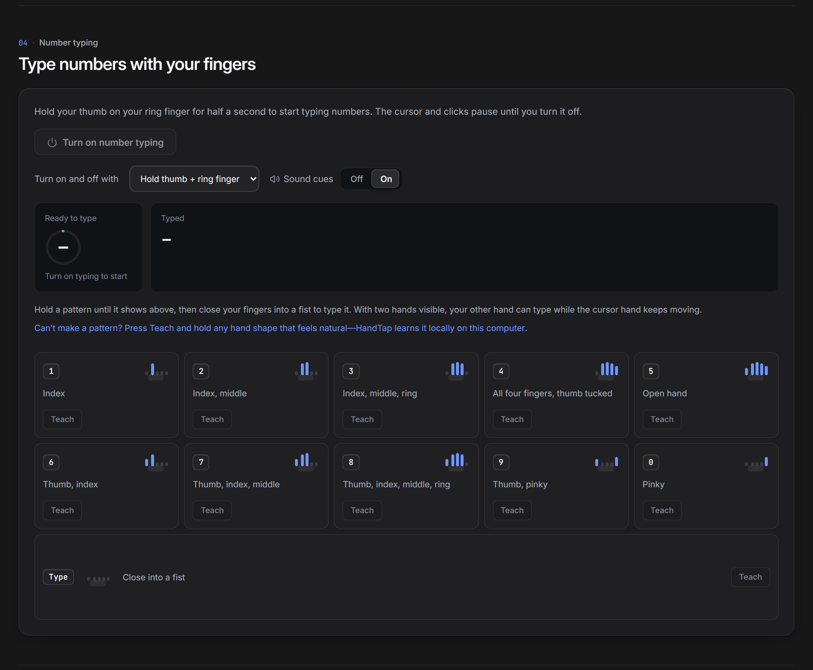
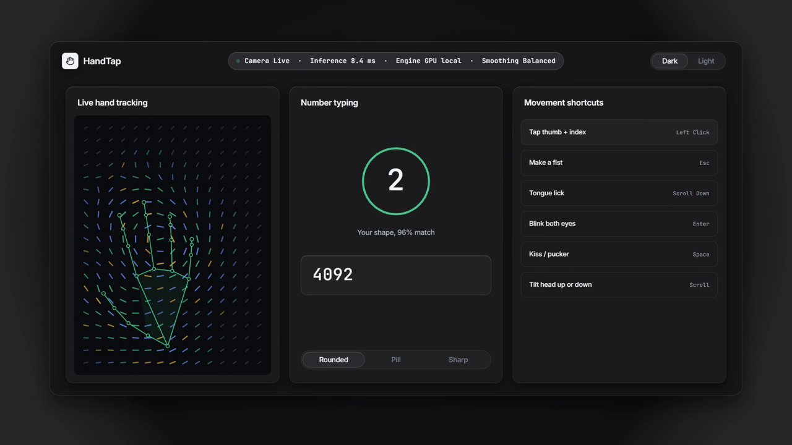

# HandTap

**Control your computer with the movements you're able to make.**

HandTap turns a webcam into a mouse and number pad using AI that runs entirely on your own computer ([watch the 1-minute film](#launch-film)). Instead of asking people to fit a fixed set of gestures, it learns the hand shapes and the range of movement that work for each person's body.



## The problem

Mice, trackpads and keyboards all assume a certain amount of grip, reach and finger control. For people with limited hand mobility, tremor, or pain from repeated movement, that can make a computer slow, tiring or out of reach.

Gesture control can help, but most of it swaps one fixed requirement for another: if your hand can't make the expected shape, it doesn't work for you. HandTap is built around changing that.

## What it does

| You do this | HandTap does this |
|---|---|
| Move your hand | Moves the real mouse cursor |
| Tap thumb and index finger | Clicks |
| Stick out your tongue | Scrolls down |
| Tilt and hold your head | Goes back or forward in a browser |
| Hold up a finger pattern, then close your hand | Types a number, 0 to 9 |
| Swipe, make a fist, or tap thumb to a finger | Presses any keyboard shortcut you choose |
| Hold thumb to a finger for half a second | Turns mouse control or number typing on and off |



### It adapts to you

- **Teach it your own gestures.** Can't make the pattern for a number, or a fist? Hold any hand shape you can for about a second and HandTap learns it. Taught on one hand, it works on the other.
- **Calibrate your reach.** Move your hand around whatever space is comfortable, however small, and that space covers your whole screen.
- **Tune it.** Adjust pinch sensitivity, and bind any movement to any of dozens of preset shortcuts, or record your own.

### It can run without touching a keyboard

The camera can start when the app opens, and everything after that can be done by hand. Sounds confirm each change, because HandTap is usually hidden behind the app you're using. `Ctrl + Alt + H` always turns mouse control off as a way out.

### Your camera stays private

Video never leaves your computer. The AI models ship inside the app, so it makes no network requests to process video and works offline.

## How the AI works

HandTap combines two kinds of on-device machine learning:

1. **Perception: [MediaPipe](https://ai.google.dev/edge/mediapipe) models.** Neural networks find 21 points on the hand and a mesh of the face, plus facial expression scores, in each camera frame.
2. **Personalisation: a model trained on you.** A [k-nearest-neighbours classifier](src/gesture-model.js) learns your gestures from about 20 frames of your own hand, with no training step and nothing uploaded. It normalises for position, distance and tilt, and refuses to guess when a shape is unlike anything it was taught.

We tuned the detection using real data rather than guesswork. Running real hand photos through the models exposed problems that synthetic tests missed, such as a thumb resting on a curled finger being read as a tap, and a fist being read as a pinch. Averaging across the hand also made a fist and a thumbs up look almost identical, which is why the classifier compares the worst-matching point instead. Those real landmarks are now [permanent regression tests](src/real-hands.test.js).

## How it's built

```mermaid
flowchart LR
  Cam[Webcam] --> Loop[Frame loop<br/>about 30 per second]
  subgraph Worker[Web worker]
    Hand[Hand model<br/>every frame]
    Face[Face model<br/>every third frame]
  end
  Loop --> Worker
  Worker --> Logic
  subgraph Logic[Gesture logic]
    Pinch[Pinch detector]
    Moves[Swipes and poses]
    Digits[Finger number reader]
    KNN[Your taught gestures]
    Filter[One Euro smoothing]
  end
  Logic --> IPC[Electron IPC<br/>validated in main process]
  IPC --> Helper[Windows input helper]
  Helper --> OS[Real mouse and keyboard]
```



Some decisions worth knowing about:

- **Detection runs in a worker,** with frames dropped rather than queued, so the interface stays responsive and the cursor doesn't lag behind the hand.
- **A One Euro filter smooths the cursor:** heavily when the hand is still, to remove jitter, and lightly when it moves fast, to avoid lag.
- **Gestures need to be meant.** Pinches use separate press and release thresholds, poses must hold for several frames, and toggles need a half-second hold, so tracking glitches and passing movements don't trigger actions.
- **The renderer can't send raw input.** It sends shortcut names, which the main process checks against a fixed list before any key is pressed.

### Project layout

| Path | What's there |
|---|---|
| `src/tracking.js` | Pinch, swipe, pose and number detection, and cursor smoothing |
| `src/gesture-model.js` | The personal gesture classifier |
| `src/hand-worker.js` | Runs the AI models off the main thread |
| `src/main.jsx` | The app and its frame loop |
| `src/fixtures/real-hands.json` | Real hand landmarks used by the tests |
| `electron/` | Desktop shell, and mouse and keyboard control |
| `public/models`, `public/wasm` | The AI models and their runtime |

## Getting started

You'll need [Node.js](https://nodejs.org) 20 or newer and a webcam. The desktop app supports native mouse and keyboard control on **Windows and macOS**. On macOS, enable HandTap in **System Settings → Privacy & Security → Accessibility**. Development builds also need Apple's Xcode Command Line Tools so the native Quartz helper can be compiled on first launch.

```bash
npm ci
npm run desktop:dev
```

Then press **Start camera**, tap your thumb and index finger on the test button, and turn on mouse control when you're ready.

| Command | What it does |
|---|---|
| `npm run desktop:dev` | Runs the desktop app in development |
| `npm test` | Runs the test suite |
| `npm run build` | Builds the app into `dist/` |
| `npm run dist` | Builds an installer into `release/` |

If you see `Electron failed to install correctly`, delete `node_modules/electron` and run `npm ci` again.

## Launch film

[](docs/handtap-launch-film.mp4)

**[Watch the launch film](docs/handtap-launch-film.mp4)** (62 seconds, 1080p, with sound). It covers tremor smoothing, clicking and dragging, reach calibration, teaching gestures, two-hand number typing, shortcuts and the eye cursor.

The film is drawn live by [`docs/launch-film.html`](docs/launch-film.html), so it can be edited like any other code. Open it in a browser and press Space to play, H to hide the controls and F for fullscreen.

## Testing

`npm test` covers gesture detection, the classifier, shortcut validation and saved settings, including real hand landmarks from MediaPipe's public test photos. [GitHub Actions](.github/workflows/ci.yml) runs the tests and a build on every push.

## Current limits

- **Not yet tested with disabled users.** This is the most important next step, and their feedback should shape what comes after it.
- Native mouse and keyboard control works on Windows and macOS. macOS requires Accessibility permission and Xcode Command Line Tools.
- Tracking needs reasonable light, and follows one hand at a time.
- Tongue detection is less reliable than hand tracking. Like every movement, it can be turned off in Keybinds.
- Typing covers numbers so far, not letters.

## Where it could go

- Test with disabled users and occupational therapists, and tune the defaults around what they find
- Face-only control for people who can't use their hands
- Teachable gestures for any action, not just numbers
- Letters, using an on-screen keyboard or taught shapes
- Linux support
- An always-visible status overlay

## Credits

Hand and face tracking use [MediaPipe](https://ai.google.dev/edge/mediapipe) by Google. Test landmarks come from MediaPipe's public test images.
